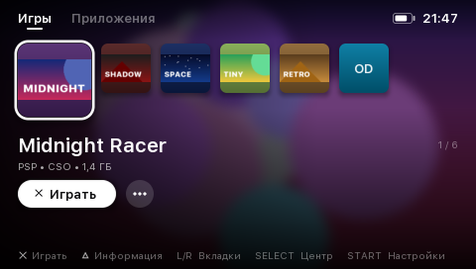
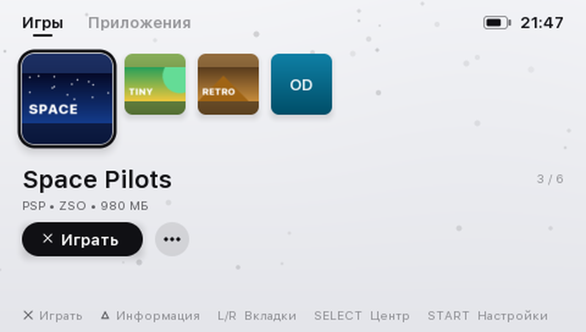
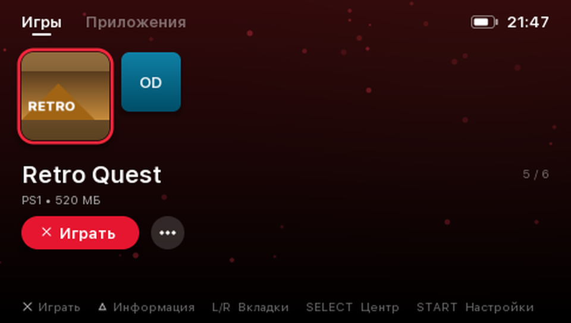
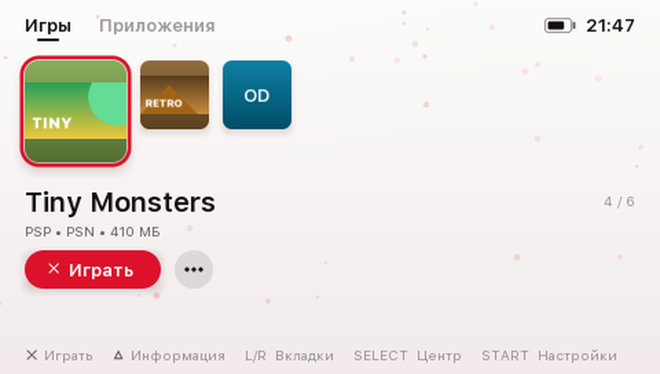
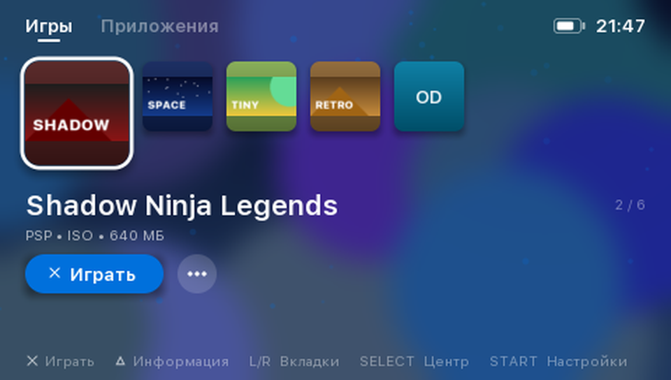
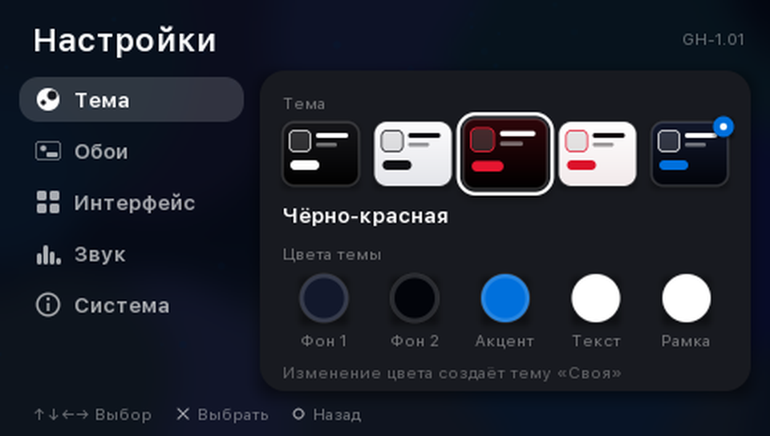
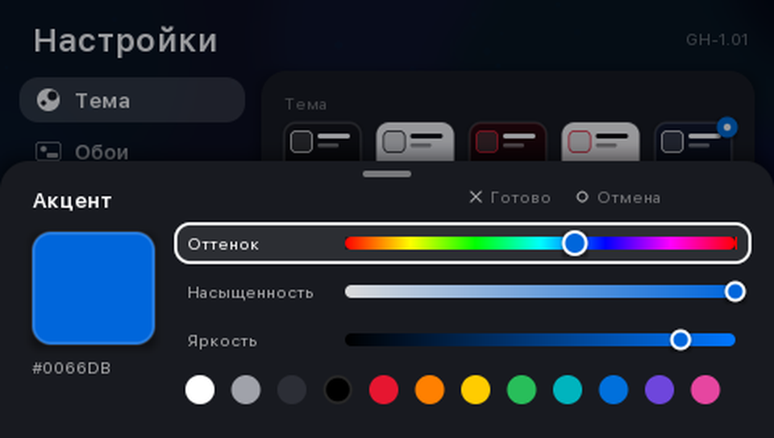
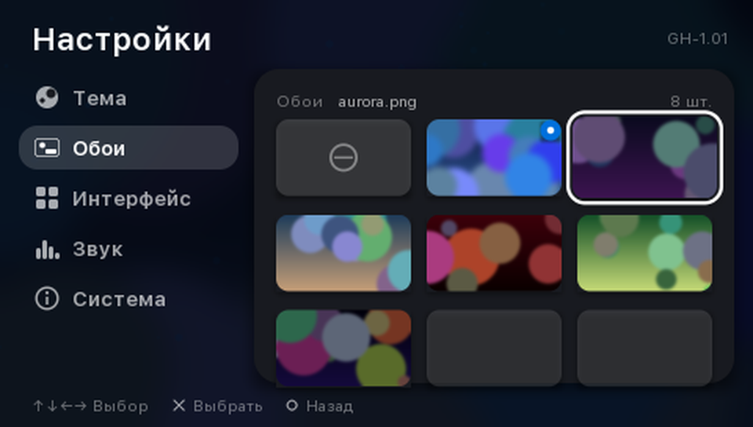
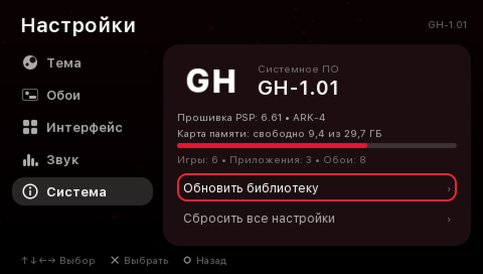
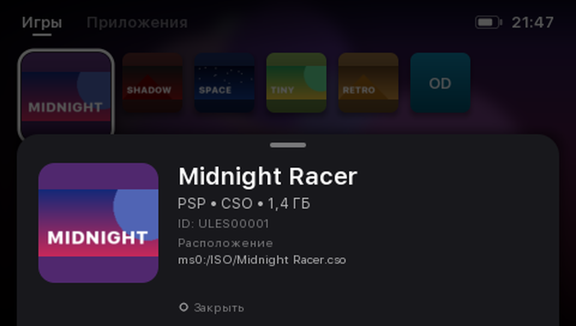

# GH-1.01

**Системное ПО в стиле PS5 для PSP-3000 / PSP-3008. Работает поверх кастомной прошивки [ARK-4](https://github.com/PSP-Archive/ARK-4).**



> [!IMPORTANT]
> **GH-1.01 работает только на ARK-4.** Это не замена прошивки во flash-памяти, а системная оболочка (homebrew `EBOOT.PBP`), которая запускается поверх кастомной прошивки **ARK-4**. Всю низкоуровневую работу делает ARK-4: эмуляцию UMD из образов ISO/CSO/ZSO/DAX/JSO (драйвер Inferno), запуск PS1-игр (POPS), PSN-игр и homebrew. GH-1.01 — это интерфейс сверху: библиотека игр, темы, обои, настройки. Через функции SystemControl ARK-4 (`sctrlKernelLoadExecVSHWithApitype`, `sctrlSESetUmdFile`, `sctrlSESetBootConfFileIndex`, `sctrlSESetDiscType`) он передаёт прошивке, какую игру запустить. Без ARK-4 GH-1.01 не запустится.

## Что это
GH-1.01 — минималистичный главный экран для запуска установленных игр в духе PS5:
- ряд плиток с обложками игр, выбранная плитка крупнее и в рамке;
- за выбранной игрой плавно проявляется её фон (PIC1), как на PS5;
- вкладки «Игры» и «Приложения», Центр управления, информация об игре;
- анимации и звуки на каждое действие;
- 4 готовые темы и полностью своя тема: любые цвета, любые обои из PNG/JPG;
- шрифт SF Pro Text с кириллицей, интерфейс на русском.

Аккаунтов и входа нет: это системное ПО, после заставки сразу открывается главный экран.

## Скриншоты
> Скриншоты — превью, отрисованные на ПК тем же шрифтом и с той же раскладкой, что в коде. Обложки игр и обои на них тестовые.

| | |
|---|---|
|  |  |
|  |  |
|  |  |
|  |  |
|  |  |

## Что запускает
| Что | Где лежит | Как запускается (через ARK-4) |
|---|---|---|
| PSP-образы ISO, CSO (v1/v2), ZSO, DAX, JSO | `ms0:/ISO/` и подпапки | драйвер Inferno, apitype 0x123 (0x124 с `PBOOT.PBP`) |
| Пропатченные образы (`EBOOT.OLD`) и обновления `PBOOT.PBP` | `ms0:/PSP/GAME/<ID>/PBOOT.PBP` | определяются автоматически |
| PSN / PSP minis | `ms0:/PSP/GAME/<папка>/EBOOT.PBP` | apitype 0x123, umdemu |
| PS1-игры (POPS) | `ms0:/PSP/GAME/<папка>/EBOOT.PBP` | apitype 0x144, pops |
| Homebrew | `ms0:/PSP/GAME/<папка>/EBOOT.PBP` | apitype 0x141 |

Значения и порядок вызовов взяты из лаунчера самой ARK-4 (`extras/menus/arkMenu/src/iso.cpp`, `eboot.cpp`). Названия игр берутся из `PARAM.SFO`, обложки — из `ICON0.PNG`, фоны — из `PIC1.PNG`. Всё это читается прямо из образов и EBOOT, распаковывать ничего не нужно.

## Установка

### 1. Поставь ARK-4
1. На PSP-3000/3008 должна быть официальная прошивка **6.61**. Если версия ниже, обнови её через официальное обновление Sony.
2. Скачай ARK-4: [последний релиз](https://github.com/PSP-Archive/ARK-4/releases).
3. Установи по инструкции из репозитория ARK-4: скопируй `ARK_Loader` и `ARK_01234` в `PSP/GAME` и `PSP/SAVEDATA`, затем запусти ARK Loader из меню «Игра».
4. После каждой полной перезагрузки ARK-4 нужно запускать заново, если ты не сделал её постоянной (например, через Infinity — смотри инструкцию ARK-4).

### 2. Скопируй GH-1.01
1. Скачай **GH-1.01.zip** из [Releases](https://github.com/gothhg0d/GH-1.01/releases/latest) и распакуй в корень карты памяти. Можно скачать только `EBOOT.PBP` или собрать его самому (см. «Сборка из исходников»).
2. В итоге файл должен лежать в `ms0:/PSP/GAME/GH101/EBOOT.PBP`. Название папки может быть любым.
3. Положи свои игры:
   - образы ISO/CSO/ZSO/… — в `ms0:/ISO/`;
   - PS1, PSN и homebrew — в `ms0:/PSP/GAME/<папка>/`.
4. По желанию положи обои (PNG/JPG) в `ms0:/PICTURE/` или в папку `wallpapers` рядом с EBOOT. Лучший размер — 480×272.

### 3. Запусти
При запущенной ARK-4 открой в XMB: «Игра» → «Карта памяти» → **GH-1.01**.

> GH-1.01 не меняет строку «Информация о системе» в XMB: ARK-4 сам пишет туда «6.61 ARK-4 …», и поменять её можно только пересборкой ARK-4. Внутри GH-1.01 версия показывается на заставке, в «Настройки → Система» и в Центре управления.

## Управление
| Кнопка | Действие |
|---|---|
| ← → (или стик) | выбор игры |
| ✕ | играть |
| △ | информация об игре (ID, формат, путь) |
| L / R | вкладки «Игры» / «Приложения» |
| SELECT | Центр управления: настройки, обновить библиотеку, звук, сон, выход |
| START | настройки |
| ○ | назад |
| L + R + SELECT | счётчик производительности (время кадра, fps, свободная память) |

## Настройки
| Раздел | Что можно настроить |
|---|---|
| **Тема** | 4 готовые темы (Чёрная, Белая, Чёрно-красная, Бело-красная) или «Своя». 5 цветов темы меняются редактором: оттенок, насыщенность, яркость и быстрые цвета. |
| **Обои** | Сетка миниатюр всех найденных картинок, затемнение, размытие, фон из игры (PIC1), подкраска фона цветом игры. |
| **Интерфейс** | Частицы, размер плиток, скругление углов, скорость анимаций (вплоть до выключения), подсказки, формат времени, вкладка при запуске. |
| **Звук** | Звуковые эффекты и фоновая музыка, у каждого своя громкость. Все звуки генерирует встроенный синтезатор. |
| **Система** | Версия GH-1.01, прошивка, место на карте памяти, обновление библиотеки, сброс настроек. |

Настройки сохраняются в `settings.cfg` рядом с `EBOOT.PBP`.

## Сборка из исходников
Каждый коммит в `main` собирается на GitHub Actions ([build.yml](.github/workflows/build.yml)), результат лежит в артефактах запуска. Чтобы собрать у себя, нужен тулчейн [pspdev](https://github.com/pspdev/pspdev): в нём уже есть libpng, libjpeg и zlib.

1. Возьми библиотеку SystemControl из ARK-4. В исходниках ARK-4 она собирается из `libs/SystemCtrlForUser` (цель `libpspsystemctrl_user.a`). Положи `libpspsystemctrl_user.a` в папку [`ark/`](ark/).
2. Собери (на Windows проще через Docker):
   ```sh
   docker run --rm -v "$PWD:/src" -w /src pspdev/pspdev make
   ```
3. Готовый `EBOOT.PBP` появится в корне проекта.

Если в тулчейне нет libjpeg, собирай через `make JPEG=0`: тогда обои будут работать только в PNG.

Шрифт заранее превращён в атлас [`src/font_data.h`](src/font_data.h). Пересобрать его (например, с другими размерами):
```sh
python tools/make_font.py <папка с SFProText-*.ttf> src/font_data.h
```

## Производительность (PSP-3000/3008)
- **Видеочип.** Всё рисует GPU через sceGu, на процессоре 333 МГц.
- **Невидимое не рисуется:** фон под обоями и под картинкой игры, главный экран под настройками.
- **Мало вызовов:** частицы рисуются одним вызовом, батарея и часы опрашиваются редко.
- **Иконки в 16 бит (RGBA5551):** до ~6 МБ памяти на 256 игр.
- **Фоновый поток:** обложки, фоны и миниатюры грузятся с низким приоритетом.
- **Быстрое размытие:** время не зависит от радиуса.
- **Лёгкий звук:** синтезатор не делает дорогих операций на каждый сэмпл и молчит, когда звук выключен.

Проверить на консоли: **L + R + SELECT**. Время кадра меньше 15 мс — запас до 60 fps есть.

## Структура
```
src/main.c        главный экран, запуск игр через ARK-4, заставка, Центр управления
src/settings.c    экран настроек: разделы, карточки тем, сетка обоев, редактор цвета
src/config.c      settings.cfg, готовые темы и «Своя»
src/gfx.c/.h      2D-рендер на GPU: скругления, тени, кольца, маски, текст UTF-8
src/audio.c/.h    синтезатор звуков и фоновой музыки
src/library.c/.h  поиск игр, чтение ISO9660/CSO/ZSO/DAX/PBP, PNG/JPEG, фоновый поток
src/font_data.h   атлас шрифта (сгенерирован tools/make_font.py)
src/version.h     название и версия: GH-1.01
tools/make_font.py генератор атласа шрифта
ark/              сюда кладётся libpspsystemctrl_user.a из ARK-4
```

## Статус
> [!WARNING]
> Проект собирается автоматически на GitHub Actions (pspdev + SystemControl из исходников ARK-4), но **ещё не проверялся на настоящей PSP**. Если найдёшь ошибку — открой issue и напиши модель PSP и версию ARK-4.

- Обложки и фоны не читаются из JSO (сжатие LZO): вместо обложки будут буквы. Сами игры запускаются через ARK-4.
- ARK-4 в архиве на GitHub, авторы перешли на ARK-5. GH-1.01 рассчитан на API SystemControl из ARK-4.

## Благодарности и лицензии
- **[ARK-4](https://github.com/PSP-Archive/ARK-4)** — кастомная прошивка, на которой работает GH-1.01 (команда PSP-Archive, GPL). Код ARK-4 в этот репозиторий не входит.
- **[pspdev / PSPSDK](https://github.com/pspdev/pspdev)** — тулчейн и SDK.
- **libpng, libjpeg, zlib** — декодирование картинок и сжатых образов.
- **Шрифт SF Pro Text © Apple Inc.** Атлас в `src/font_data.h` и скриншоты сделаны из него. На SF Pro действует лицензия Apple, а не лицензия этого проекта.
- PlayStation и PSP — торговые марки Sony Interactive Entertainment. Проект с Sony не связан.
